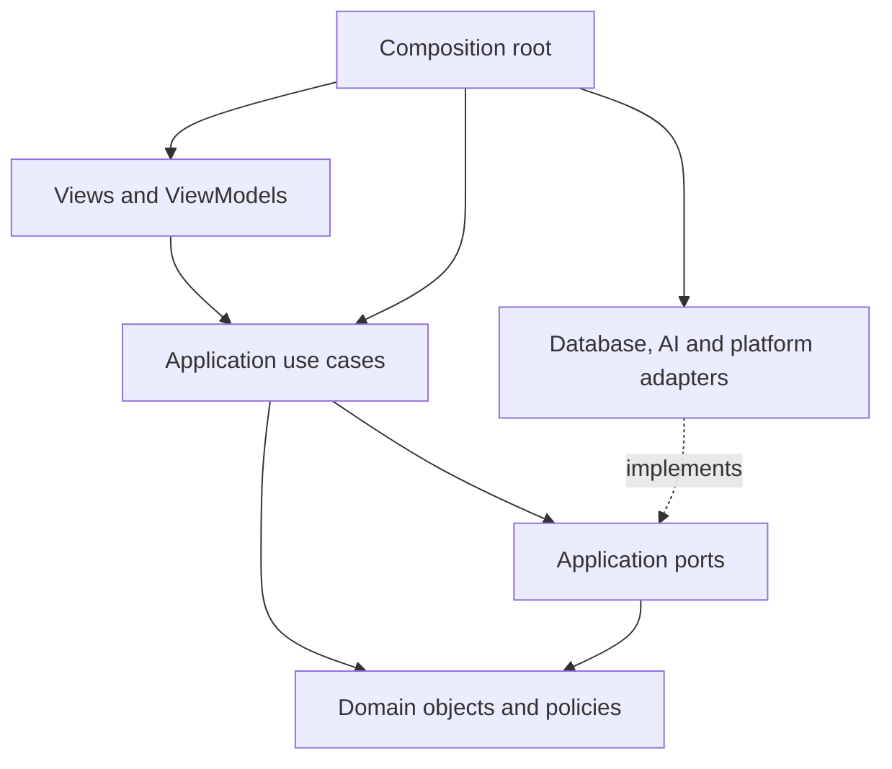

# Architecture

Status: accepted design; implementation has not started.

OmniQuiz is a local-first Flutter application for Android, iOS, Windows,
macOS, and Linux. Users supply their own AI API credentials. There is no
OmniQuiz backend. Web, cloud synchronization, and subscription-based AI
sign-in are outside the initial scope.

## Technology decisions

| Concern | Decision |
| --- | --- |
| UI | Flutter and Dart; adaptive layouts |
| Presentation | MVVM with immutable view state and ChangeNotifier view models |
| Dependency injection | Constructor injection; Provider exposes objects to the widget tree |
| Persistence | SQLite through Drift, with database work off the UI isolate |
| Networking | package:http behind an AI provider adapter |
| Credentials | A CredentialStore port backed by platform secure storage |
| Navigation | go_router, owned by the presentation layer |
| Document access | Platform adapters for file import and desktop directory access |
| Background work | A persistent local job queue driven while the app is active |

Choose and lock compatible dependency versions when scaffolding the app.
Validate secure storage and file-access plugins on each target before release.
Do not assume that one plugin supports every platform equally.

## Dependency boundaries



- **Presentation** renders state, collects input, and invokes use cases.
- **Application** coordinates workflows and defines the external capabilities
  they require as narrow interfaces.
- **Domain** owns learning rules, valid questions, and value objects. It imports
  neither Flutter nor database, networking, or platform packages.
- **Infrastructure** implements ports and translates database rows, provider
  responses, and platform handles into application/domain types.
- **Composition root** constructs concrete objects and injects their dependencies.

Domain and application code must remain usable from ordinary Dart tests.
View models never execute SQL, construct HTTP requests, or read files.
Repositories own persistence, not scheduling or AI orchestration. They do not
call other repositories; a use case coordinates cross-repository work.

## Object-oriented design rules

1. Give each class one reason to change. Parsing, generation, validation,
   scheduling, and persistence belong to separate collaborators.
2. Depend on interfaces at external boundaries. Inject repositories, provider
   adapters, clocks, and file access through constructors.
3. Prefer composition to inheritance. Do not introduce BaseRepository,
   BaseViewModel, a global service locator, or a universal manager object.
4. Keep interfaces focused on consumers' needs. File picking and directory
   watching are separate capabilities; mobile adapters need not fake watching.
5. Preserve substitutability. Provider adapters use the same result and failure
   contracts, and declare unsupported features before a request is submitted.
6. Keep invariants inside objects. A Question cannot be constructed with missing
   answer options, duplicate option IDs, or an answer outside its options.
7. Expose immutable snapshots and intention-revealing methods rather than public
   mutable collections. Do not add an interface for every internal class.

## Core objects

| Object | Responsibility |
| --- | --- |
| StudyCollection | The user's chosen material scope and study preferences |
| SourceDocument / DocumentRevision | File identity and an immutable content version |
| SourceChunk / SourceReference | Extracted text and stable references to its revision and location |
| KnowledgePoint | A study topic linked to supporting source chunks |
| Question / AnswerOption | An immutable, validated single-choice question and explanation |
| AnswerAttempt | An immutable submission, selected option, timestamp, and outcome |
| ReviewState | A derived review projection for a question or knowledge point |
| StudySession | Current practice scope and progression |
| ProviderProfile | Endpoint, model, capabilities, and a credential reference; never the secret |
| GenerationJob | A durable request snapshot, lifecycle, retry metadata, and result identity |

Start with single-choice questions. Support additional question types only when
needed, using explicit variants rather than a large object with nullable fields.
A wrong answer creates or updates review state. A single later correct answer
does not automatically erase its learning history.

## Application workflows and ports

| Workflow | Collaborators |
| --- | --- |
| ImportMaterials | DocumentAccess, DocumentParser, MaterialRepository |
| PrepareStudyScope | MaterialRepository, KnowledgePointExtractor, KnowledgeRepository |
| RefillQuestionBuffer | BufferPolicy, ContextBuilder, GenerationJobRepository |
| ExecuteGenerationJob | AiQuestionGenerator, QuestionValidator, QuestionBatchStore |
| SubmitAnswer | AnswerEvaluator, ReviewPolicy, StudyProgressStore |
| LoadPractice / LoadReview | QuestionRepository, StudyProgressRepository |
| ConfigureProvider | ProviderProfileRepository, CredentialStore, ProviderProbe |

Use cases may share focused policies, but must not form circular dependencies.
Application ports describe business operations, not SQL tables or HTTP payloads.

Important contracts:

- `AiQuestionGenerator.generate(request)` returns untrusted question candidates
  and any available usage metadata. It does not write to the database.
- `DocumentParser.parse(input)` returns extracted content and locations. A parser
  registry selects by supported format; unsupported files produce explicit errors.
- `QuestionBatchStore.completeJob(jobId, questions)` atomically inserts accepted
  questions and completes a job. Retrying completion must not duplicate results.
- `StudyProgressStore.recordAttempt(attempt, reviewChange)` atomically records an
  attempt and updates the review projection; repeated attempt IDs are idempotent.
- `CredentialStore` reads, writes, and deletes secrets by opaque reference.
- `Clock` and `IdGenerator` allow reproducible scheduling and retry tests.

These are design contracts, not implemented Dart APIs.

## AI boundary

Begin with one OpenAI-compatible Chat Completions adapter and configurable
endpoint/model. Compatibility is a protocol target, not a guarantee that all
providers support identical parameters. Keep provider DTOs inside the adapter.

A provider capability profile describes structured-output support and known
request limits. Use schema output where supported, otherwise parse JSON and
validate it locally. Provider or model changes do not change domain objects.

Build each request from selected source chunks, study objectives, and bounded
recent-question summaries. Persist parsing results; never reread and resend an
entire library for every question. Prompt caching is an optional provider
optimization, not a requirement for correctness. No persistent remote session
is required.

Treat source text as data, not instructions. Validate structure, answer
membership, source-reference membership, and exact/near duplicates before
publishing a question. Structural checks cannot establish factual correctness;
retain source excerpts, support user reports, and add semantic review as a
separate validator when needed. Never present model confidence as proof.

Use typed failures for authentication, rate limits, network errors, invalid
output, unsupported formats, permission loss, and cancellation. Retry transient
failures with bounded backoff; do not endlessly retry invalid credentials.
Do not log prompts, document contents, credentials, or authorization headers.
A timeout after submission may still incur provider charges; do not promise
exactly-once remote execution.

## Question buffer and job lifecycle

A single GenerationCoordinator owns scheduling. It composes the refill and
execution use cases and listens to practice consumption and app lifecycle events.
It contains no UI, provider-specific, or SQL logic.

Initial tunable settings: low watermark 5, target 20, batch size 10, one active
AI request. On an empty queue, schedule the first batch immediately. Recalculate
after each job and count pending work to avoid excessive generation.

```text
queued -> running -> completed
             |----> retryScheduled -> queued
             |----> failed
queued/running/retryScheduled -> cancelled
```

Claim jobs atomically. Persist a lease for running jobs; recover expired leases
on startup. Bound retries and queue size. Persist valid results before offering
them to the user. If no candidates pass validation, fail the batch explicitly.

Each job captures collection, source revisions, provider profile version, model,
and generation settings. Recheck relevance before publishing results. Cancel
obsolete jobs when users change scope, delete sources, or replace credentials;
do not refill another scope with late results. Preserve completed questions for
historical attempts even if their sources become stale.

On mobile, generation is best-effort while active. Pause scheduling when the app
is suspended and recover persisted work on return. Cached questions remain usable
offline. Do not require background execution or a constantly running process.

## Storage and platform behavior

Drift owns tables, transactions, migrations, and mapping. Store source revisions,
chunks, knowledge points, questions/options/references, attempts, review state,
provider profiles, and jobs. Large imported files live in app-managed storage;
SQLite stores their metadata and relative paths.

Hash imported content to identify changed revisions. Use temporary files and a
recoverable import state because filesystem writes and database transactions
cannot be one atomic operation. Removing or replacing a source invalidates its
pending work and marks related questions stale without deleting study history.

Desktop can select a directory and incrementally scan it. Phone users import
files into managed storage. Persist platform permission handles where needed,
and report permission loss instead of silently dropping materials. Keep parser
selection separate from file selection. Start with TXT/Markdown, then text PDF;
OCR and office formats are later increments.

Secrets use platform secure storage; never fall back silently to plaintext.
No analytics or automatic cloud uploads. The user initiates generation knowing
that selected source excerpts are sent to their chosen provider.

## Planned source layout

```text
lib/
  main.dart
  app/                 # composition root, lifecycle, routing, theme
  presentation/
    library/           # views, view models, immutable view state
    practice/
    review/
    settings/
  application/
    use_cases/
    ports/
    generation/        # coordinator, job orchestration, context builder
  domain/
    materials/
    questions/
    learning/
    generation/
  infrastructure/
    persistence/       # Drift schema, migrations, repository adapters
    ai/                # provider adapters and transport DTOs
    documents/         # parser implementations
    platform/          # file access, lifecycle, credential storage

test/                  # mirrors domain/application/infrastructure boundaries
integration_test/      # real persistence and platform workflows
```

Keep one Flutter package initially. Split packages only when dependency
boundaries or reuse justify the additional tooling.

## Verification and implementation order

1. Scaffold Flutter, dependency composition, navigation, and adaptive app shell.
2. Add local persistence, migrations, provider settings, and secure credentials.
3. Import text materials with revision tracking and source references.
4. Add provider probing, generation, candidate validation, and persistence.
5. Add the durable buffer, cancellation, retries, and lifecycle recovery.
6. Add practice, atomic attempt recording, and review scheduling.
7. Add text PDF import and validate platform packaging on each target.

Commit each independently verified increment. Run format, static analysis, and
relevant tests before its commit. Pure domain tests cover question invariants and
review rules. Use fake clocks and providers to test refill concurrency, retry
limits, cancellation, and stale results. Database tests cover migration,
idempotency, and crash recovery. Integration tests cover import-to-practice and
secure storage on supported platforms. Live API smoke tests are opt-in and use
user-supplied credentials; normal CI makes no paid requests.

## References

- [Flutter architecture guide](https://docs.flutter.dev/app-architecture/guide)
- [Flutter dependency injection](https://docs.flutter.dev/app-architecture/case-study/dependency-injection)
- [Drift native platforms](https://drift.simonbinder.eu/platforms/vm/)
- [Drift isolates](https://drift.simonbinder.eu/isolates/)
